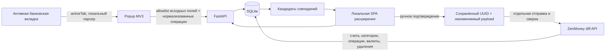

# Технический проект MVP

## Цель и границы

Личный инструмент одного владельца: вручную открыть операции банка, импортировать отображённые строки, сопоставить счета, проверить кандидатов и отправить подтверждённые доходы/расходы в ZenMoney. Пользователь разрешил выбор стека и немедленное создание skeleton; перечисленные решения приняты для этого объёма. Полный интерактивный plan-eng-review отдельно не проводился.

## Уточнение целевой архитектуры: Docker и история

Новые обязательные требования пользователя: backend и тесты в Docker локально и на сервере, исторический импорт банка, более длительная история ZenMoney и подсказки категорий по подтверждённым историческим связям. Docker и MV3-интерфейс проверены. История ZenMoney реализована со схемой v2 и отдельным read-only клиентом; живая полнота не проверена. История реальных банков и подсказки пока не реализованы. Описание существующих таблиц и логики ниже отражает skeleton.

Контейнеризация: один runtime-образ backend, конфигурация окружением, постоянное хранилище БД/outbox, раздельные DEMO/LIVE данные, отдельные test-инструменты. Расширение остаётся приложением Chrome пользователя; браузерные тесты выполняются в контейнере Chromium/Playwright. Секреты и финансовые данные не включать в образы.

Исторический поток: части страниц банка → сессия исторического импорта с контролем охвата → банковское хранилище; длительная история ZenMoney → зеркало → подтверждённые связи с банковскими операциями → примеры категоризации → рекомендация для новой операции → review. Первая загрузка истории не запускает отправку операций.

Требуются расширения текущей схемы: метаданные импортируемых периодов/частей и прогресса; структурированные исходные и нормализованные признаки получателя; происхождение и версия рекомендации категории. Конкретные таблицы/миграции определить при реализации. Существующие `imports` и `linked_id` дают основу, но не реализуют управление полнотой истории или обучающие примеры полностью.

Matching устанавливает тождество двух записей; категоризация ищет похожие примеры, поэтому не ограничивается равной суммой и датой ±2 дня. Использовать получателя и доступные признаки, показывать основания, учитывать исправления/удаления и не превращать неподтверждённую рекомендацию в обучающий пример. Качество проверять на более поздней истории, не используя её ответы при подборе правил.

Глубину истории ещё нужно согласовать. Фактическую полноту загрузки ZenMoney проверить через документированные возможности API; cursor фиксирует синхронизацию, а не доказательство покрытия выбранного периода.

## Порядок уточнения архитектуры

По последнему решению пользователя сначала готовятся Docker и интерфейс расширения. Затем отдельно оценивается библиотека ZenMoney или создаётся самостоятельный клиентский пакет. Окончательная схема БД определяется после инвентаризации доступных API-сущностей; актуальная схема 11 описана в `docs/zenmoney-storage.md`; matching читает точные JSON сущностей из структурированных таблиц. Банковские таблицы и matching проектируются после хранилища ZenMoney, а живые изменения ZenMoney вводятся в последнюю очередь. Схема ниже описывает целевой поток и существующий прототип, а не порядок внедрения.

## Поток данных

## Решения

- **FastAPI + Pydantic:** строгий входной контракт и OpenAPI без отдельного описания DTO. Серверные зависимости зафиксированы в requirements.lock.txt.
- **SQLite WAL:** один владелец, один процесс, короткая установка. BEGIN IMMEDIATE сериализует изменения; очередь и audit долговечны. Пока сетевой diff выполняется внутри транзакции: это блокирует записи на время сетевого запроса (timeout 60 секунд на фазу), но упрощает согласованность cursor и зеркала. Для большого объёма — PostgreSQL, отдельный worker и блокировка sync по владельцу.
- **Vanilla JavaScript SPA:** интерфейс на отдельной extension page; сборщик и frontend framework для этого skeleton не нужны. DOM формируется через textContent, банковские строки не становятся HTML.
- **MV3 activeTab:** временный доступ только после вызова пользователем. Нет фонового наблюдения, банковских паролей, cookies, запросов к внутреннему API банка или обхода авторизации.
- **Серверный ZenMoney token:** расширение хранит только отдельный API_TOKEN в chrome.storage.local. Удалённый backend требует HTTPS и разрешение пользователя на конкретный origin.
- **DEMO по умолчанию:** mock diff использует тот же серверный pipeline; режим фиксируется в БД. Живой API клиент и демоданные разделены.

## Модель данных

| Таблица | Содержимое и инвариант |
|---|---|
| bank_accounts | unique(bank, account), currency, явный zenmoney_account |
| imports | Каждый принятый пакет, версия адаптера, время приёма, исходный JSON |
| bank_transactions | Исходные поля отдельно от нормализованных; unique(bank_account, external_id) |
| zen_* | Полные структуры API и точные JSON сущностей; zen_entities удалена в схеме 11 |
| meta | Режим БД и serverTimestamp; cursor обновляется атомарно с зеркалом |
| outbox | Один payload и один UUID на подтверждённую банковскую операцию |
| audit | Импорт, mapping, решения оператора, возврат на проверку, отправка |

Деньги хранятся целыми минимальными единицами. Сравнение с ZenMoney выполняется через Decimal. Поддерживаются VND, USD, EUR; остальные валюты отклоняются. Дата сохраняется как локальная банковская календарная дата, часовой пояс не угадывается.

## Дедупликация и matching

1. Банковский reference идентифицирует операцию только внутри конкретного банковского счёта. Тот же ID и те же поля — повтор; изменившаяся сумма/дата/описание — конфликт и rollback всего пакета.
2. Разные ID при одинаковой сумме и дате остаются разными операциями.
3. Сопоставление счёта требует совпадения валюты и неархивного ZenMoney account. Отношение один к одному; после link/queue/send менять mapping нельзя.
4. Кандидаты: движение по выбранному счёту с точной суммой и датой в пределах двух дней. Deleted/hold игнорируются. Перевод в зеркале может быть кандидатом по соответствующей стороне, но создавать переводы MVP не умеет.
5. Перед подтверждением выполняется sync. Клиент передаёт набор увиденных candidate IDs; изменение набора приводит к 409 и повторной проверке.
6. Оператор выбирает link/create/ignore. Нельзя связать две банковские операции с одной уже связанной/отправленной записью ZenMoney.

## Отправка и сбои

`pending → queued → sent`; отдельно `linked`, `ignored`. В outbox попытка сначала фиксируется как `uncertain`, затем выполняется сеть. Подтверждение не отправляет деньги/операции само по себе.

После таймаута следующая попытка сначала синхронизирует зеркало. Если сохранённый UUID уже есть и значимые поля совпадают, операция отмечается sent без повторной записи. Если поля отличаются, фиксируется conflict. Если UUID отсутствует, отправляется тот же неизменяемый payload. Это стратегия повторов с устойчивым ID, а не обещание распределённого exactly-once. Поведение live API необходимо проверить на тестовой операции владельца.

Первый sync запрашивает все документированные коллекции из `FORCE_FETCH` с serverTimestamp=0 и forceFetch. Следующие используют последний успешно зафиксированный serverTimestamp. Ответ и удаления применяются вместе с cursor. Сетевой сбой/невалидный ответ не сдвигает cursor.

Перед отправкой повторно проверяются mapping и кандидаты. Новые совпадения блокируют запись. Ещё не отправлявшийся queued можно вернуть на review, удалив его неподанный payload. Для uncertain это запрещено: удалённая запись уже могла быть создана.

## Ограничения согласованности

Изменения в самом ZenMoney между последней сверкой и отправкой невозможно атомарно заблокировать. При ручных изменениях одновременно с импортом возможна новая похожая операция; пользовательская сверка остаётся обязательной. Нет планировщика и фоновых retries: оператор явно запускает sync/send. Запуск более одного worker не поддерживается.

## Проверка и развитие

Автотесты покрывают транзакционные границы, повторные запросы, сбой после удалённого commit, конкурентное подтверждение, matching, валюты, отклонение некорректного ввода и HTTP-контракт. Отдельный тест выполняет код адаптера. Ручной acceptance: загрузка extension в Chrome, demo bank, import, mapping, confirm, send, повтор.

Следующий этап: получить названия трёх банков и обезличенные DOM fixtures; разработать адаптеры с fail-closed проверками; проверить live OAuth и diff на согласованной тестовой операции; реализовать исторический импорт банков, категоризацию и последующую запись; пагинация истории ZenMoney и миграция v2 уже добавлены. При переносе на PostgreSQL сохранить unique constraints и долговечный outbox.

## Источники

- [ZenMoney API](https://github.com/zenmoney/ZenPlugins/wiki/ZenMoney-API) — официальный diff, сущности и OAuth.
- [Chrome activeTab](https://developer.chrome.com/docs/extensions/get-started/tutorial/scripts-activetab) — временный доступ по действию пользователя.
- [Chrome MV3 API migration](https://developer.chrome.com/docs/extensions/develop/migrate/api-calls) — scripting.executeScript.
- [FastAPI / Pydantic models](https://fastapi.tiangolo.com/tutorial/request-form-models/) — запрет лишних полей модели.

Документация FastAPI и Chrome проверена через Context7 2026-10-05. ZenMoney не найден в Context7; использована официальная wiki.

Актуальные детали клиента и БД: `docs/zenmoney-client.md`, `docs/zenmoney-storage.md`. Старый outbox/confirm остаётся demo-прототипом; в LIVE работают отдельные маршруты подтверждённого создания и обновления категорий.

Самостоятельная библиотека ZenMoney и границы компонентов описаны в
[решении о разделении API-клиента](zenmoney-library.md).
